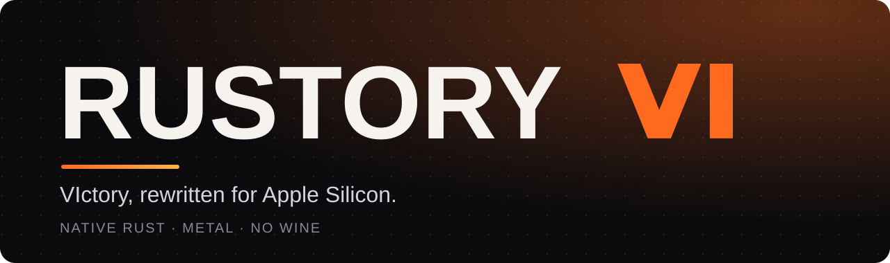
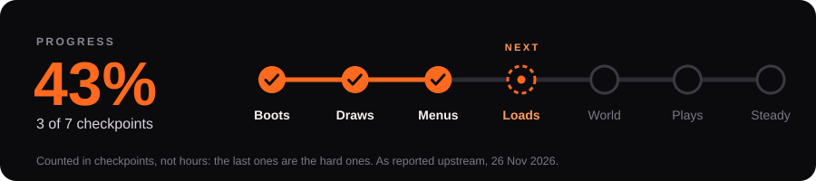
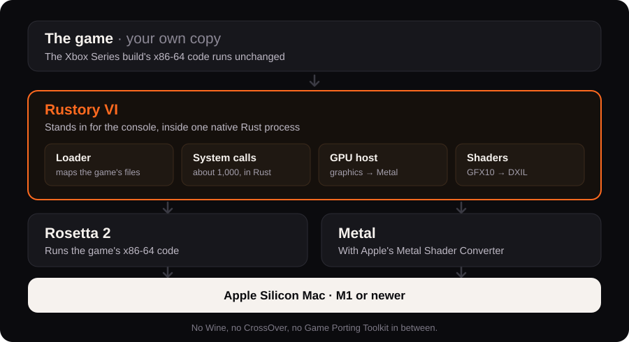

<p align="center">
  
</p>

<p align="center">
  <a href="https://discord.gg/E65kyCNgSS"></a>
  <a href="ROADMAP.md"></a>
  <a href="CONTRIBUTING.md"></a>
</p>

<p align="center">
  
  
  
  
  
</p>

**Rustory VI** is a native Apple Silicon runtime for the Xbox Series build of GTA VI. The game's code runs in our own process, its graphics go straight to Metal, and there is no Wine, CrossOver or Game Porting Toolkit in between. It boots, draws and shows its menus. It is **not playable yet**.

It is a community build of [Native VIctory for macOS](https://github.com/LakshanSivakumar/Native-Victory-macOS) by LakshanSivakumar, which in turn builds on [VIctory](https://github.com/Marvisak/VIctory) by Marvisak. The foundation is theirs; see [Credits](#credits).

> [!IMPORTANT]
> **No game files here, ever.** You need your own legally obtained copy of the game. Rustory VI is unofficial and not affiliated with Rockstar Games, Take-Two, Microsoft or Apple.

## Where are we?

<p align="center">
  
</p>

Menus on screen, world not yet. The [roadmap](ROADMAP.md) shows what comes next and where you can jump in.

<details>
<summary>What the seven checkpoints mean</summary>

| | Checkpoint | It counts when |
|:-:|---|---|
| ✅ | **Boots** | the game's own code starts and runs natively on a Mac |
| ✅ | **Draws** | frames appear in a window, rendered on Metal |
| ✅ | **Menus** | the start screen and menus react to the keyboard |
| ⬜ | **Loads** | it gets through the loading screens into the first scene |
| ⬜ | **World** | the 3D world renders correctly |
| ⬜ | **Plays** | you control a character and the world responds |
| ⬜ | **Steady** | a long session keeps a steady frame rate and doesn't crash |

Status as reported by upstream on 26 November 2026. We haven't measured it independently yet, and every checkpoint counts the same, so read the percentage as a rough feel, not a forecast.

</details>

## How it works

<p align="center">
  
</p>

The game's x86-64 code runs under Rosetta 2. We reimplement the Windows and Xbox system calls it makes, turn the console's graphics commands into Metal, and translate its shaders on the way. Fewer layers than the Wine route means fewer places to break.

## Quick start

You need an Apple Silicon Mac on macOS 15 or newer with about 20 GB free, [rustup](https://rustup.rs) (not Homebrew's `rust`), Apple's free [Metal Shader Converter](https://developer.apple.com/metal/shader-converter/), and **your own copy of the game files**.

```bash
git clone https://github.com/starsix55/rustory-vi.git
```

```bash
cd rustory-vi && tools/macos/native-setup.sh
```

```bash
tools/macos/run-native.sh /path/to/your/game/folder
```

The setup script checks Rosetta, the Xcode command line tools, rustup and the Shader Converter, tells you what's missing, then builds. Point the run script at the folder that holds `game_scarlett_master.exe`: a window opens, stays black for a few seconds, then shows the boot movie and the menus. The log lands in `runs/`.

<details>
<summary>Keyboard controls</summary>

Click the window and the keyboard drives the game's gamepad. The run script also presses Enter for you every two seconds for the first 80 s, to get past the start screen.

| Keys | Pad |
|---|---|
| Enter, Space | A |
| Escape, Backspace | B |
| X, Y | X, Y |
| Arrow keys | D-pad |
| W A S D | left stick |
| Tab | Menu (Start) |
| Q, E | left, right shoulder |
| Z, C | left, right trigger |

Real controllers aren't supported yet. Add `--headless` to run without a window, or `--seconds 60` to stop after a minute.

</details>

Then [tell us how it went](https://github.com/starsix55/rustory-vi/issues/new?template=tester-report.yml). A tester report from your Mac, whatever chip and RAM it has, helps more than you'd think.

## Help us

| 🧪 **Test it** | 🎨 **Graphics & Metal** | 🦀 **Rust & systems** | 🧩 **Compilers** |
|---|---|---|---|
| Run it on your Mac and file a [tester report](https://github.com/starsix55/rustory-vi/issues/new?template=tester-report.yml). No code needed. | Guessed pipeline state, refused shaders, a GPU timeout. | Missing system calls, speed, tests. | The arm64 recompiler isn't in this repo yet: ask in an issue. |

Pull requests are welcome from anyone, under any name. Start with a [good first issue](https://github.com/starsix55/rustory-vi/labels/good%20first%20issue), read [CONTRIBUTING](CONTRIBUTING.md), and ask on [Discord](https://discord.gg/E65kyCNgSS) before starting anything big. You can stay fully anonymous; CONTRIBUTING shows how.

## What this repo adds

Experiments in how the game's memory maps onto Metal, on top of upstream commit [`07e6c59`](https://github.com/LakshanSivakumar/Native-Victory-macOS/commit/07e6c598f613d16c9f2cfa35fc0fed2de0cf09a2) (26 Nov 2026):

- DirectStorage completion semantics, and keeping file references alive for queued reads
- Sharing host textures that alias the same title memory, and evicting unused ones under a budget
- Lazy descriptor-heap realization, so only the textures a draw can reach get created
- Native Metal texture copies, plus row-pitch, mip and depth/stencil layout fixes
- Memory accounting (title, Metal, compressor, paging) and persistent queue-lag tracing
- A written-down [seam between the GPU host and Metal](docs/backend-seam.md)

Catching up with upstream's newer commits is the first item on the [roadmap](ROADMAP.md).

## Credits

Rustory VI exists because other people did the hard part first.

- **[Native VIctory for macOS](https://github.com/LakshanSivakumar/Native-Victory-macOS)** by [LakshanSivakumar](https://github.com/LakshanSivakumar) and contributors: the native macOS port this repo is built on.
- **[VIctory](https://github.com/Marvisak/VIctory)** by Marvisak and contributors: the Xbox Series emulator it all started from.
- **[VIctory for macOS](https://github.com/pragyaangaur/VIctory-macOS)** by Pragyaan Gaur and contributors: the Wine-based Mac route that came first.

Their full commit history is kept in this repository. We also studied design ideas from [Xenia](https://github.com/xenia-project/xenia), [shadPS4](https://github.com/shadps4-emu/shadPS4), [DXMT](https://github.com/3Shain/dxmt) and [XCL](https://github.com/xcl-dev/xcl); [docs/backend-seam.md](docs/backend-seam.md) says what we took and what we didn't. Licensed under the [GPL-3.0](LICENSE).

## Legal

This project contains no game code, assets, keys or Microsoft or Apple SDK files, and never will. You must supply your own legally obtained copy of the game. Do not post game files or links to them in issues or pull requests.

Not affiliated with or endorsed by Rockstar Games, Take-Two Interactive, Microsoft or Apple. All trademarks belong to their owners.
