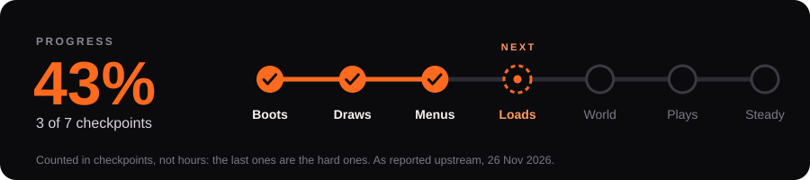

# Roadmap

  

Pick whatever looks fun. Items with an issue number have a starting point written down. Quick questions go on [Discord](https://discord.gg/E65kyCNgSS).

> [!NOTE]
> The open problems below were measured at upstream commit `07e6c59` (26 Nov 2026). Upstream has moved on by hundreds of commits since, so some of them may already be fixed there. That's why step one is catching up. The technical detail behind each item, with addresses and every diagnostic switch, lives in [docs/ROADMAP.md](docs/ROADMAP.md) and [docs/native-host.md](docs/native-host.md).

## Now: catch up and stay alive

- [ ] Catch up with upstream's newer commits (#1)
- [ ] Get past the Metal GPU timeout at about 53 s (#2)

## Next: see the world

- [ ] Get through the loading screens to the first scene
- [ ] Stop guessing culling, depth, stencil and write mask (#4)
- [ ] The seven refused shader shapes (#3)
- [ ] Share textures by format view and by range overlap (#7)

## Later: play it

- [ ] Real controllers (#5)
- [ ] Reverb (#6)
- [ ] Mesh shaders and indirect draws
- [ ] Speed and frame pacing
- [ ] Run without Rosetta. The arm64 recompiler isn't in this repo yet; ask in an issue if you want it
- [ ] The prologue, playable

## Anytime

- [ ] Run it on your Mac and file a [tester report](https://github.com/starsix55/rustory-vi/issues/new?template=tester-report.yml)
- [ ] Make the setup scripts work on more Macs (#8)
- [ ] Turn a finding in `docs/native-host.md` into a unit test (#9)

## Done

- [x] The game boots natively: loader, TLS, exceptions, threads
- [x] About 1,000 Windows and Xbox system calls, enough for the boot
- [x] Loading through DirectStorage
- [x] A Metal pipeline for every draw, built from the console's own descriptions
- [x] Boot movie, start screen and menus on screen with correct text and blending (other screens not checked yet)
- [x] Sound through CoreAudio (reverb is still silent)
- [x] Keyboard as gamepad
